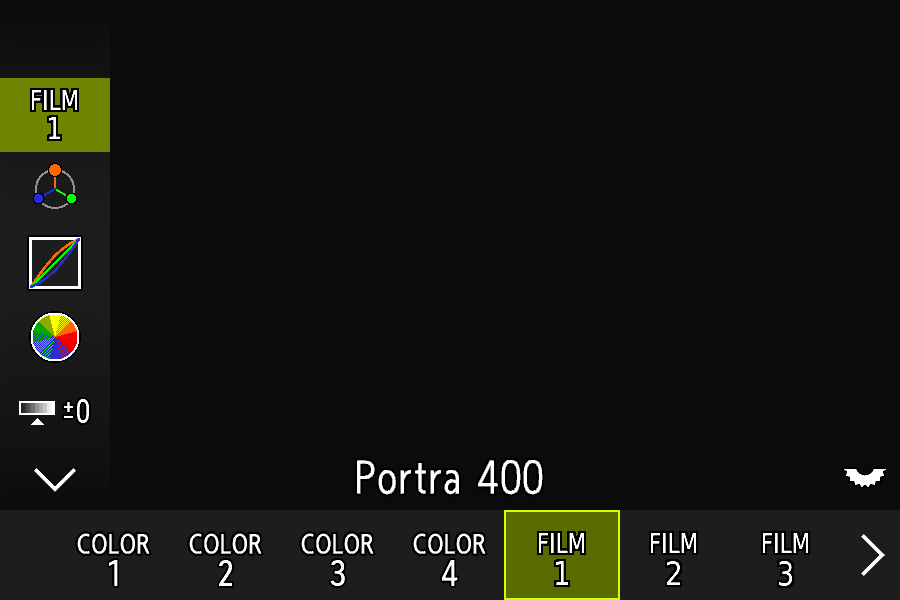
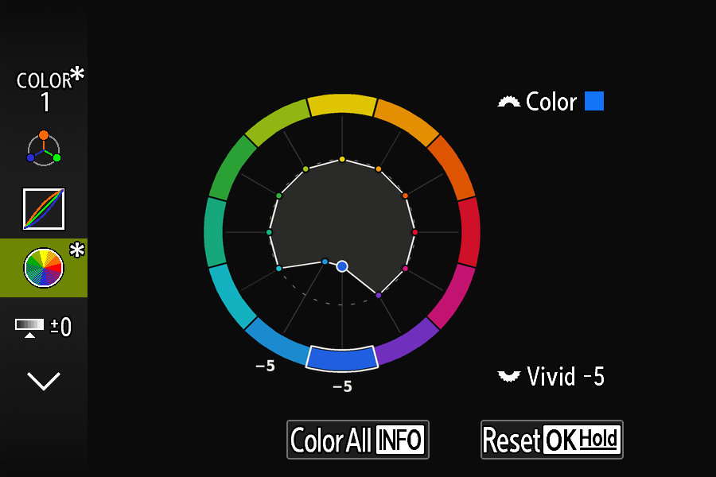

<!-- Generated by scripts/atlas.py. Edit canonical records/metadata, then regenerate. -->

# Caduceus for OM-3

Film looks and a full colour editor, built into the OM SYSTEM OM-3.

[Project home](https://github.com/androidfanman/caduceus-om3){ .btn .btn-primary }
[Ask or report issues](https://github.com/androidfanman/caduceus-om3/issues){ .btn .btn-ghost }
[Tour](https://androidfanman.github.io/caduceus-om3/){ .btn .btn-ghost }
[Install guide](https://androidfanman.github.io/caduceus-om3/pages/install/){ .btn .btn-ghost }
[Using it](https://androidfanman.github.io/caduceus-om3/pages/using/){ .btn .btn-ghost }
[LookLab](https://androidfanman.github.io/caduceus-om3/looklab/){ .btn .btn-ghost }
[Roadmap](https://androidfanman.github.io/caduceus-om3/pages/roadmap/){ .btn .btn-ghost }

**Type:** mod · **Latest release:** [v0.30.3](https://github.com/androidfanman/caduceus-om3/releases/tag/v0.30.3), 16 Nov 2026 · **Maintained by** [androidfanman](https://github.com/androidfanman)
{ .facts }

{ .hero-image }

FILM 1, Portra 400, on a sample photo from the project's tour. *Caduceus for OM-3 tour; photo by Pierre Blaché, public domain.*
{ .image-caption }

## About

Caduceus for OM-3 adds 20 film simulations and a colour editor to the OM-3's own Picture Mode. The films appear as FILM 1–20 after COLOR 1–4, each with its name on screen, and you can fine-tune any of them on the camera: hue, saturation and brightness for 12 colours, split toning, curves, grain, glow and halation.

Looks are made and shared in LookLab, a browser tool that previews a film on sample photos or your own and saves one file for the card. Since v0.29 the films and your changes live in the camera's own memory, so any card works, or none at all.

It is open source, for the OM-3 on firmware 1.1 only, and grew out of Caduceus for the E-P7. The project calls it experimental: it can crash or freeze the camera, and the launcher keeps a restore file so you can go back to OM's firmware.

### What it's working towards

- Make Color Profile mode the best JPEG maker of any camera. With v0.28 the owner considers the colour profiles complete for now.
- Video comes next in the owner's order of work.
- Lens and focus requests are planned: focus stacking with any autofocus lens, and aperture rings on Panasonic lenses.

> **Before you install:** Installing modified firmware is at your own risk. Follow the project's own guide for your exact camera and firmware, and read its safety notes first.

## Features

As the project describes them. Status is the project's own; linked evidence is the Atlas's record of what was reported or observed.

**Your films in Picture Mode** Available
{ .feature-head }

FILM 1–20 appear after COLOR 1–4, with their names on the title, quick menu, shooting screen and viewfinder.

[OM-3](../cameras/om3.md) · since v0.24.1
{ .card-meta }

**20 film simulations** Available
{ .feature-head }

Looks inspired by Portra, Gold, Ektar, Ektachrome, Kodachrome, CineStill 800T, Velvia, Provia, Superia and more, made only from the camera's own settings.

[OM-3](../cameras/om3.md)
{ .card-meta }

**Colour editor on the camera** Available
{ .feature-head }

Hue and luminance for each of 12 colours next to the camera's saturation, with Color Mix and RGB curves since v0.30.

[OM-3](../cameras/om3.md) · since v0.11 · [Evidence](../capabilities/om3-hsl.md)
{ .card-meta }

**Split toning** Available
{ .feature-head }

Tint shadows and highlights separately in 12 colours, with a Tone Balance row. Shows in live view.

[OM-3](../cameras/om3.md) · since v0.26
{ .card-meta }

**Film grain** Available
{ .feature-head }

Colour grain made by the camera's image processor, as fast as a photo without grain.

[OM-3](../cameras/om3.md) · since v0.25
{ .card-meta }

**Glow, clarity and halation** Available
{ .feature-head }

A Glow / Clarity row, and halation: a red glow around bright lights, strength 0–5.

[OM-3](../cameras/om3.md) · since v0.28
{ .card-meta }

**Changes kept per film** Available
{ .feature-head }

Edits stay with each film over power off. A * marks what changed; hold OK to reset.

[OM-3](../cameras/om3.md) · since v0.25
{ .card-meta }

**Films stored in the camera** Available
{ .feature-head }

Films, your changes and the Extras settings live in the camera's memory, so any card works, or none.

[OM-3](../cameras/om3.md) · since v0.29
{ .card-meta }

**White balance per film** Available
{ .feature-head }

Each film and COLOR remembers its white balance mode and Kelvin.

[OM-3](../cameras/om3.md) · since v0.28
{ .card-meta }

**Buttons and Creative Dial** Available
{ .feature-head }

All four arrow keys in Button Function; each Creative Dial position set to CRT, ART, COLOR or MONO, with its own film.

[OM-3](../cameras/om3.md) · since v0.27
{ .card-meta }

**Film recipe in every photo** Available
{ .feature-head }

Each JPEG records its film and recipe in EXIF, so LookLab can open the film from a photo.

[OM-3](../cameras/om3.md) · since v0.27
{ .card-meta }

**LookLab** Available
{ .feature-head }

Make and change films in your browser with a preview on sample photos or your own, starting from 62 looks. Nothing is uploaded.

[OM-3](../cameras/om3.md)
{ .card-meta }

**Films from your LUTs and Lightroom presets** Testing
{ .feature-head }

LookLab finds the camera settings closest to a .cube LUT or a Lightroom preset, with a match score.

[OM-3](../cameras/om3.md)
{ .card-meta }

**Focus stacking with any lens** Planned
{ .feature-head }

The camera's focus stacking and bracketing with any autofocus lens, not only OM's listed ones.

[OM-3](../cameras/om3.md)
{ .card-meta }

**Panasonic aperture rings** Planned
{ .feature-head }

The aperture ring on Panasonic lenses that have one sets the aperture.

[OM-3](../cameras/om3.md)
{ .card-meta }

**Crop modes** Testing
{ .feature-head }

XPan, 21:9 and 5:4 Image Aspect choices; JPEGs are saved at that shape and RAW keeps the whole sensor with the crop marked. Photos only.

[OM-3](../cameras/om3.md) · since v0.40-alpha
{ .card-meta }

**White border and own film grain** Testing
{ .feature-head }

A white Border per film (0 to 5, JPEG only), and the project's own colour grain with strength 1 to 5 and a Grain Size row.

[OM-3](../cameras/om3.md) · since v0.40-alpha
{ .card-meta }

## Gallery

The films sit in Picture Mode after COLOR 1–4. *Caduceus for OM-3 tour.*
{ .image-caption }

Per-colour editing on the camera's colour wheel. *Caduceus for OM-3 tour.*
{ .image-caption }

Halation at strength 5 on a sample photo. *Caduceus for OM-3 tour; photo by Blervis, CC0.*
{ .image-caption }

## Releases

**[Caduceus for OM-3 v0.40-alpha (test version)](https://github.com/androidfanman/caduceus-om3/releases/tag/v0.40-alpha)** Pre-release · 18 Nov 2026
{ .release-head }

- Crop modes XPan, 21:9 and 5:4 for JPEGs; RAW keeps the whole sensor with the crop marked.
- A white border per film, and the project's own film grain with strength and size.
- Picture Mode stays open 30 s; start-up waits for the camera's ready signal before running patch code.

A test version; the project says v0.30.3 stays the current version. LookLab does not know the new settings yet.
{ .release-warning }

**[Caduceus for OM-3 v0.30.4-alpha (test version)](https://github.com/androidfanman/caduceus-om3/releases/tag/v0.30.4-alpha)** Pre-release · 17 Nov 2026
{ .release-head }

- Fixes a camera restart when switching films quickly.
- Colour wheel labels read Sat, Hue, Lum or Tint.
- Looks such as split toning, curves and Glow are now photo-only, not applied to video.

A test version; the project says v0.30.3 stays the current version.
{ .release-warning }

**[Caduceus for OM-3 v0.30.3](https://github.com/androidfanman/caduceus-om3/releases/tag/v0.30.3)** · 16 Nov 2026
{ .release-head }

- Halation photos save about twice as fast, with a smoother halo fade.
- RGB and Mix pages move one step per dial click; curves redraw about three times faster.
- Fixes a late shutter and runaway bursts with the debug log on.

**[Caduceus for OM-3 v0.30.2](https://github.com/androidfanman/caduceus-om3/releases/tag/v0.30.2)** · 16 Nov 2026
{ .release-head }

- Fixes a black review picture and a frozen live view with Glow, Clarity or Halation.

**[Caduceus for OM-3 v0.30.1](https://github.com/androidfanman/caduceus-om3/releases/tag/v0.30.1)** · 16 Nov 2026
{ .release-head }

- Fixes a one-frame menu flash in Picture Mode.

**[Caduceus for OM-3 v0.30](https://github.com/androidfanman/caduceus-om3/releases/tag/v0.30)** · 16 Nov 2026
{ .release-head }

- New: Color Mix and RGB curves on the camera, with the 20 films regraded to use them.
- New Picture Mode row order.
- Fixes for mode-dial changes, a video freeze and the Noise Filter marker.

**[Caduceus for OM-3 v0.29.5](https://github.com/androidfanman/caduceus-om3/releases/tag/v0.29.5)** · 15 Nov 2026
{ .release-head }

- Custom modes keep their own copy of your films and changes.
- Fixes a lost Contrast change made in P.

After updating, assign your custom modes once.
{ .release-warning }

**[Caduceus for OM-3 v0.29.4](https://github.com/androidfanman/caduceus-om3/releases/tag/v0.29.4)** · 15 Nov 2026
{ .release-head }

- Fixes the * markers in Picture Mode and keeps changes when switching off straight after.
- Display fixes and a Custom WB fix for films.

**[Caduceus for OM-3 v0.29.3](https://github.com/androidfanman/caduceus-om3/releases/tag/v0.29.3)** · 14 Nov 2026
{ .release-head }

- The Delete button can take a shooting function.

**[Caduceus for OM-3 v0.29.2](https://github.com/androidfanman/caduceus-om3/releases/tag/v0.29.2)** · 14 Nov 2026
{ .release-head }

- Custom modes C1–C5 no longer change your films; each brings back the films it was assigned with.

**[Caduceus for OM-3 v0.29.1](https://github.com/androidfanman/caduceus-om3/releases/tag/v0.29.1)** · 13 Nov 2026
{ .release-head }

- Films load with no card in the camera.

## Cameras

[OM SYSTEM OM-3](../cameras/om3.md).

## Where to talk

[Caduceus Discord](../community/caduceus-discord.md), [r/M43](../community/m43.md). For a reproducible bug, use the project's issue tracker.

## Related work

[Caduceus for E-P7](caduceus-ep7.md), [OM-Emu](om-emu.md). These links do not assign ownership or imply identical implementations.

## Research notes

The reviewed README names v0.30.3. Camera-test descriptions remain attributed; this catalogue has not reproduced them.

## Sources and record

- [Caduceus OM-3 overview](../sources/om3.readme.md)
- [OM-3 LookLab](../sources/om3.looklab.md)
- [OM-3 research index](../sources/om3.research.md)
- [Caduceus OM-3 roadmap](../sources/om3.roadmap.md)
- [Caduceus OM-3 releases](../sources/om3.releases.md)
- [OM-3 v0.40-alpha release notes](../sources/om3.v040.md)

[Canonical record](../../records/projects/caduceus-om3.yaml) · Substantively reviewed: 2026-11-17.
