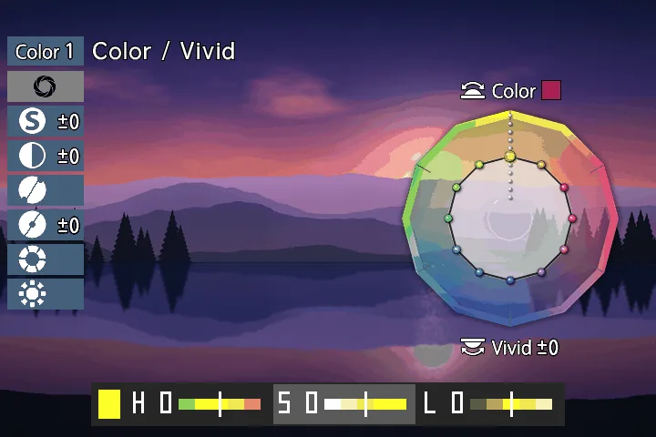
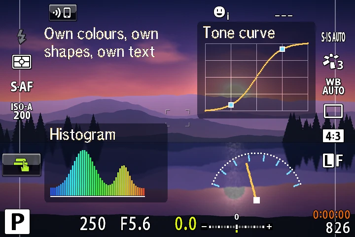
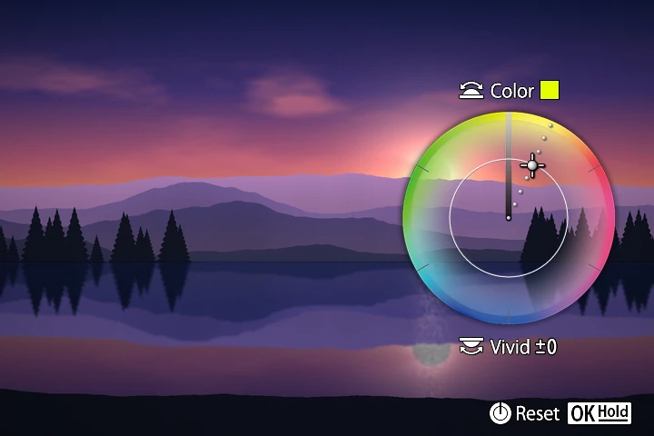
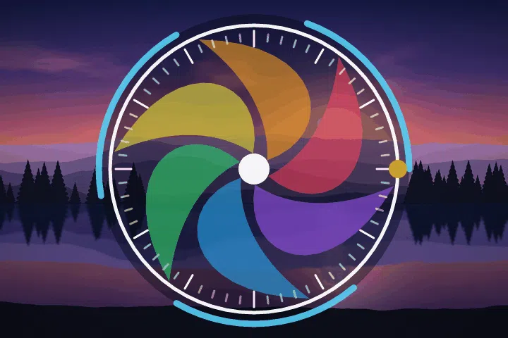

<!-- Generated by scripts/atlas.py. Edit canonical records/metadata, then regenerate. -->

# Olympus firmware notes (E-M5 Mark III)

How the E-M5 Mark III firmware works, and bringing OM-5 features to it.

<div class="cta-row" markdown="1">

[Project home](https://github.com/nsud-dev/olympus-firmware-notes){ .btn .btn-primary }
[Ask or report issues](https://github.com/nsud-dev/olympus-firmware-notes/issues){ .btn .btn-ghost }
[Firmware guides](https://github.com/nsud-dev/olympus-firmware-notes/blob/c6eaab8f0eaaa21ca2a1af0f4990b79c5b1ddd7a/docs/guides/README.md){ .btn .btn-ghost }
[Overview of everything studied](https://github.com/nsud-dev/olympus-firmware-notes/blob/main/docs/overview.md){ .btn .btn-ghost }
[Gotchas](https://github.com/nsud-dev/olympus-firmware-notes/blob/main/docs/reference/gotchas.md){ .btn .btn-ghost }

</div>

<details class="research-action" markdown="1"><summary>Research this project with AI</summary>

Copy this into your coding agent and replace the bracketed text. [How to use the Atlas with your AI](../../docs/research-with-ai.md).

```text
Use the Atlas entry for Olympus firmware notes (E-M5 Mark III) (https://github.com/xulfr/om-firmware-atlas/blob/main/views/projects/em5-iii-notes.md) to investigate [my question] on [my exact camera and firmware].
```

</details>

[Share a research finding](../../docs/research-with-ai.md#share-what-you-find)

**Type:** research · **Camera details:** [OM-D E-M5 Mark III](#for-em5-iii) · **Maintained by** [nsud-dev](https://github.com/nsud-dev)
{ .facts }

## Cameras

<div class="model-panel" markdown="1">

### OM-D E-M5 Mark III { #for-em5-iii }

**For this camera:** Notes and tools only; no builds are published. The author's own test builds on one E-M5 III cover focus stacking with any lens, Live ND and its live-view preview ported from the OM-5, a Color / Monochrome Profile editor, and a parked USB webcam. Drawing your own screens and GPU graphics is so far shown in the om-emu emulator only.
{ .card-for }

**Get it:** [Firmware guides](https://github.com/nsud-dev/olympus-firmware-notes/blob/c6eaab8f0eaaa21ca2a1af0f4990b79c5b1ddd7a/docs/guides/README.md)
{ .card-get }

[Camera overview and test results](../cameras/em5-iii.md)

</div>



{ .hero-image }

Editing a colour profile on the wheel, in the om-emu emulator with our c3d patches. The bottom hue, saturation and lightness strip is our own test addition. Emulator only, not yet run on a camera. *olympus-firmware-notes; om-emu by its contributors (MIT); generated backdrop, no photo.*
{ .image-caption }

## About

A study of the Olympus OM-D E-M5 Mark III firmware 1.7: container format, boot and section loading, recovery, the MN103 CPU, memory map, image engine, ARM co-processor, display, stabiliser, shooting sequencer, settings and menus, with comparisons against the OM-5, OM-5 II, E-M1 III, OM-1 and PEN-F.

The aim is to run features of newer bodies on the E-M5 III, mainly Live ND and Handheld High Res from the OM-5. Each page tags claims as seen on the camera, read in the code, or inferred, and gives dates.

Tools: olyfw.py unpacks and repacks E-M5 III update files and fixes their checksums; ptpinfo.py reads PTP device info; osdlab, c3d_vg and a set of om-emu patches (with om-emu's MIT notice) draw on the GUI layers and the vector GPU in the om-emu emulator. No firmware images, disassembly or patched builds are included.

## Features

As the project describes them. Status is the project's own; linked evidence is the Atlas's record of what was reported or observed.

<div class="feature-grid" markdown="1">

<div class="feature-card" markdown="1">

**Focus stacking with any lens** <span class="pill pill-research">Research</span>
{ .feature-head }

A two-byte change to the lens check lets any lens that passes the lens-type check use in-camera focus stacking.

[OM-D E-M5 Mark III](../cameras/em5-iii.md) · [Evidence](../capabilities/em5-iii-focus-stacking-any-lens.md)
{ .card-meta }

</div>

<div class="feature-card" markdown="1">

**Live ND (port from the OM-5)** <span class="pill pill-research">Research</span>
{ .feature-head }

A full Live ND shot from one press, ND2 to ND16, merged by the OM-5's image-engine job 11, with a Noise Reduction dark pass at low ISO, in test builds on one camera. Builds are not published.

[OM-D E-M5 Mark III](../cameras/em5-iii.md) · [Evidence](../capabilities/em5-iii-live-nd.md)
{ .card-meta }

</div>

<div class="feature-card" markdown="1">

**Live ND live-view simulation (port from the OM-5)** <span class="pill pill-research">Research</span>
{ .feature-head }

Live view shows the Live ND blur, averaged over up to 240 frames by the OM-5's job 12, with restarts on shutter changes and movement, in test builds.

[OM-D E-M5 Mark III](../cameras/em5-iii.md) · [Evidence](../capabilities/em5-iii-live-nd-preview.md)
{ .card-meta }

</div>

<div class="feature-card" markdown="1">

**Color / Monochrome Profile editor** <span class="pill pill-research">Research</span>
{ .feature-head }

The hidden Color and Monochrome Profile modes made selectable, with an on-camera editor (E-M1 III wheel routines relocated, a side bar of rows, a per-profile tone curve with the live histogram) whose edits show in live view and photos, in test builds.

[OM-D E-M5 Mark III](../cameras/em5-iii.md) · [Evidence](../capabilities/em5-iii-profile-editor.md)
{ .card-meta }

</div>

<div class="feature-card" markdown="1">

**Drawing your own graphics (GUI layers)** <span class="pill pill-research">Research</span>
{ .feature-head }

How to draw boxes, curves, pictures, camera-font text, see-through palettes and animation on the GUI layers with the camera's own calls; checked in the om-emu emulator, with the osdlab script.

[OM-D E-M5 Mark III](../cameras/em5-iii.md)
{ .card-meta }

</div>

<div class="feature-card" markdown="1">

**Drawing with the vector GPU (c3d / OpenVG)** <span class="pill pill-research">Research</span>
{ .feature-head }

The camera's OpenVG library and c3d driver mapped; own renderers written in C run in om-emu, which now shows the GPU layer through our patches and a JavaScript OpenVG stand-in. Not run on a camera yet.

[OM-D E-M5 Mark III](../cameras/em5-iii.md)
{ .card-meta }

</div>

<div class="feature-card" markdown="1">

**USB webcam (parked)** <span class="pill pill-research">Research</span>
{ .feature-head }

Test builds enumerate as a UVC webcam and stream a generated picture; live view over USB failed, so the work is parked.

[OM-D E-M5 Mark III](../cameras/em5-iii.md) · [Evidence](../capabilities/em5-iii-uvc-webcam.md)
{ .card-meta }

</div>

<div class="feature-card" markdown="1">

**Firmware and hardware notes** <span class="pill pill-research">Research</span>
{ .feature-head }

Tagged, dated pages on the container, boot, recovery, CPU, memory map, image engine, ARM side, display, stabiliser, settings and menus.

[OM-D E-M5 Mark III](../cameras/em5-iii.md)
{ .card-meta }

</div>

<div class="feature-card" markdown="1">

**Firmware modification techniques** <span class="pill pill-research">Research</span>
{ .feature-head }

Twenty-one techniques from the E-M5 III 1.7 work, each with its method, pitfalls and a per-camera checked-on table that credits other projects' results.

[OM-D E-M5 Mark III](../cameras/em5-iii.md)
{ .card-meta }

</div>

<div class="feature-card" markdown="1">

**Firmware process guides** <span class="pill pill-research">Research</span>
{ .feature-head }

Walk through E-M5 III 1.7 boot, button input, shooting, live view, updates and frame pools, with links into the reference notes.

[OM-D E-M5 Mark III](../cameras/em5-iii.md)
{ .card-meta }

</div>

</div>

## Gallery

<div class="gallery" markdown="1">

<div class="gallery-item" markdown="1">



An overlay drawn with the GUI's own calls over the shooting screen, in the om-emu emulator. *olympus-firmware-notes; om-emu by its contributors (MIT).*
{ .image-caption }

</div>

<div class="gallery-item" markdown="1">



The stock Color Creator wheel, drawn by the camera's own c3d code in om-emu once the GPU layer is shown. *olympus-firmware-notes; om-emu by its contributors (MIT).*
{ .image-caption }

</div>

<div class="gallery-item" markdown="1">



Our own renderer on the camera's vector GPU, running in the om-emu emulator with our c3d patches. Emulator only, not yet run on a camera. *olympus-firmware-notes; om-emu by its contributors (MIT); generated backdrop, no photo.*
{ .image-caption }

</div>

</div>

## Related work

[Ghidra MN103 processor module](ghidra-mn103.md), [Olympus firmware research](oly-fw-analysis.md), [OM-Emu](om-emu.md). These links do not assign ownership or imply identical implementations.

## Research notes

Notes and tools only; no firmware or builds are published. Every claim is tagged [camera], [code] or [inferred]. Camera results come from one E-M5 III.

## Sources and record

- [E-M5 III notes overview](../sources/em5n.readme.md)
- [What the E-M5 III project has looked into](../sources/em5n.overview.md)
- [Live ND on the E-M5 III](../sources/em5n.live-nd.md)
- [Focus stacking lens check patch](../sources/em5n.focus-patch.md)
- [USB webcam](../sources/em5n.webcam.md)
- [E-M5 Mark III firmware guides](../sources/em5n.guides.md)
- [E-M5 III drawing to the screen guide](../sources/em5n.guide-drawing.md)
- [E-M5 III guide: drawing your own graphics](../sources/em5n.guide-own-graphics.md)
- [E-M5 III guide: drawing with the vector GPU](../sources/em5n.guide-vector-gpu.md)
- [osdlab: drawing on the GUI layers in om-emu](../sources/em5n.tool-osdlab.md)
- [c3d_vg: own renderers for the vector GPU](../sources/em5n.tool-c3d-vg.md)
- [om-emu c3d patches and runner](../sources/em5n.tool-omemu-c3d.md)

[Canonical record](../../records/projects/em5-iii-notes.yaml) · Substantively reviewed: 2026-11-21.
