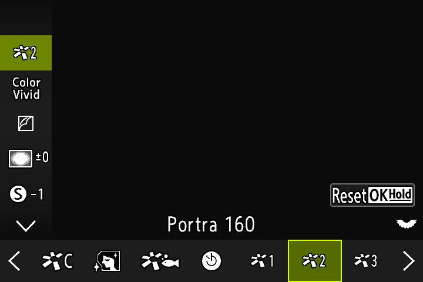
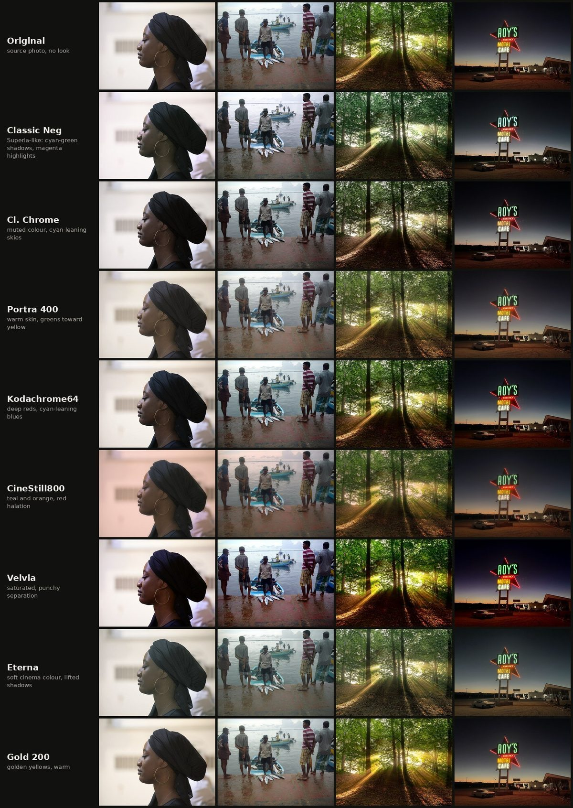
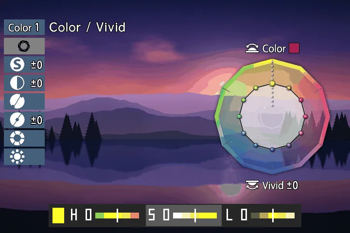

<!-- Generated by scripts/atlas.py. Edit canonical records/metadata, then regenerate. -->

# Projects

Independent projects by members of the community, each with its own home, maintainers and support route. Features are described as each project describes them. A listing does not imply endorsement.

## Camera modifications

{ .card-image }

[Caduceus for OM-5](caduceus-om5.md){ .card-title }

Looks and a full colour editor for the OM-5 Mark II. Experimental.

Color Profiles 1–3 and Monochrome Profiles 1–3 · Custom looks · Colour editor
{ .card-features }

For: OM-5 Mark II
{ .card-cameras }

Latest: v0.2.0-alpha1 (pre-release), 20 Nov 2026
{ .card-meta }

{ .card-image }

[Caduceus for OM-3](caduceus-om3.md){ .card-title }

Film looks and a full colour editor, built into the OM SYSTEM OM-3.

Your films in Picture Mode · 20 film simulations · Colour editor on the camera
{ .card-features }

For: OM-3
{ .card-cameras }

Latest: v0.40.3-beta2 (pre-release), 20 Nov 2026
{ .card-meta }

{ .card-image }

[Caduceus for E-P7](caduceus-ep7.md){ .card-title }

The original Caduceus: HSLFX colour editing and 29 film looks for the PEN E-P7.

On-camera look editor (HSLFX) · 29 film simulations · Colour mix and base curve
{ .card-features }

For: PEN E-P7
{ .card-cameras }

Latest: v0.34a, 15 Nov 2026
{ .card-meta }

[om10mi-mods](om10mi-mods.md){ .card-title }

Film looks, a colour wheel, colour editors and a longer video limit for the original OM-D E-M10.

Film looks · Per-sector colour editor · Per-look colour editor
{ .card-features }

For: OM-D E-M10 (Mark I)
{ .card-cameras }

Latest: v87, 21 Nov 2026
{ .card-meta }

[db firmware / om-c-firmware](db-firmware.md){ .card-title }

Feature patches across many OM SYSTEM and Olympus bodies, from aperture rings to new burst rates.

Panasonic aperture rings · Korean menus · Quasi-LUT and DBLink
{ .card-features }

For: OM-5, OM-5 Mark II, OM-3, PEN E-P7, PEN-F
{ .card-cameras }

Latest: dbv0.4.3, 21 Nov 2026
{ .card-meta }

**OM-5:** The project reports that this build does not work on this camera. **OM-5 Mark II:** The project reports that this build does not work on this camera. [Read release notes](https://github.com/azqeurio/om-c-firmware/releases/tag/dbv0.4.3).
{ .release-warning }

[E-M1 Mark III Mod Builder](em1-iii-mod-builder.md){ .card-title }

Pick firmware mods for the E-M1 Mark III and build your own update file.

Panorama 65:24 · Multiple Exposure with 3 and 4 frames · Focus stacking with any lens
{ .card-features }

For: OM-D E-M1 Mark III
{ .card-cameras }

Latest: mod-builder-1.18, 21 Nov 2026
{ .card-meta }

[OMKit](omkit.md){ .card-title }

A loader flashed once, then core, modules and settings from the SD card. OM-5 Mark II.

Card-loaded core and modules · Creative profiles (CREATPRF) · Film look (FILMLOOK)
{ .card-features }

For: OM-5 Mark II
{ .card-cameras }

Latest: v0.1.0, 20 Nov 2026
{ .card-meta }

[EPM2Mod](epm2mod.md){ .card-title }

Film simulations, interval shooting, focus peaking and a level gauge for the PEN E-PM2.

Film simulations · Interval shooting · Level gauge
{ .card-features }

For: PEN E-PM2
{ .card-cameras }

Latest: v2026.11.20-rc.1 (pre-release), 20 Nov 2026
{ .card-meta }

[OM-3 downstream experiments](camera-stuff.md){ .card-title }

A downstream OM-3 fork for trying fixes before sending them upstream.

For: OM-3
{ .card-cameras }

Experimental fork
{ .card-meta }

[Caduceus port for the original OM-5 (tadejs)](caduceus-om5-tadejs.md){ .card-title }

Groundwork for bringing Caduceus to the original OM-5. Not released.

Camera test ladder C1–C5 · COLOR 1–3 back end · LCD tint fix
{ .card-features }

For: OM-5
{ .card-cameras }

Experimental fork
{ .card-meta }

## Research and tools

{ .card-image }

[Olympus firmware notes (E-M5 Mark III)](em5-iii-notes.md){ .card-title }

How the E-M5 Mark III firmware works, and bringing OM-5 features to it.

Focus stacking with any lens · Live ND (port from the OM-5) · Live ND live-view simulation (port from the OM-5)
{ .card-features }

For: OM-D E-M5 Mark III
{ .card-cameras }

Research
{ .card-meta }

[Olympus firmware research](oly-fw-analysis.md){ .card-title }

The research base: PEN-F HSL, firmware formats and tools for many bodies.

PEN-F HSL · Firmware toolkit · Findings by topic
{ .card-features }

For: PEN-F
{ .card-cameras }

Latest: alpha-20261017 (pre-release), 18 Oct 2026
{ .card-meta }

[OM-Emu](om-emu.md){ .card-title }

Run OM SYSTEM and Olympus camera firmware in your browser.

Browser player · Patch overlays · Caduceus release checks
{ .card-features }

For: OM-5, OM-5 Mark II, OM-3, PEN E-P7, PEN-F, OM-D E-M10 Mark IV
{ .card-cameras }

Emulator
{ .card-meta }

[Historical manual update research](manual-update.md){ .card-title }

How to install official OM SYSTEM firmware from an SD card.

SD card firmware update
{ .card-features }

For: OM-5, OM-3
{ .card-cameras }

Reference
{ .card-meta }

[Ghidra MN103 processor module](ghidra-mn103.md){ .card-title }

Read MN103 camera firmware in Ghidra, with the decompiler.

MN103 disassembly and decompiler · Pointer-register calling convention
{ .card-features }

For: OM-D E-M5 Mark III, OM-5, OM-5 Mark II, PEN-F, PEN E-P7
{ .card-cameras }

Tool
{ .card-meta }

