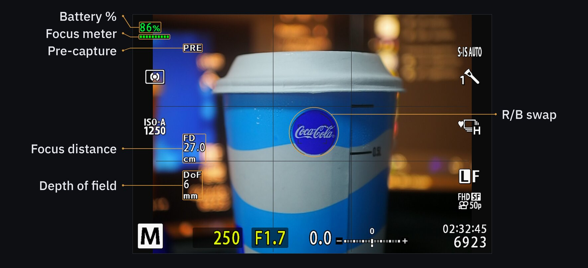

<!-- Generated by scripts/atlas.py. Edit canonical records/metadata, then regenerate. -->

# Olympus OM-D E-M10 Mark II showcase

[Camera overview](../cameras/em10-ii.md)

**[Before you install](../../docs/before-you-install.md)** · Unofficial firmware can leave your camera stuck restarting or unable to start. Recovery from a memory card is not guaranteed.
{ .install-note }

<section class="model-panel" markdown="1">

## fenykl { #fenykl }

**Get it:** No release for this camera yet.
{ .card-get }

{ .hero-image }

The main plugin's additions on the live-view INFO screen. *fenykl README.*
{ .image-caption }

[Full project details](../projects/fenykl.md#for-em10-ii) · [Ask or report issues](https://github.com/atx/fenykl/issues)

</section>
