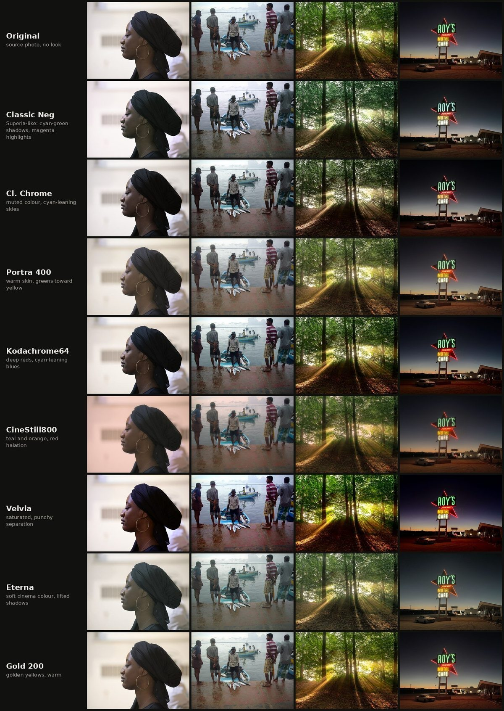

<!-- Generated by scripts/atlas.py. Edit canonical records/metadata, then regenerate. -->

# Olympus PEN E-P7 showcase

[Camera overview](../cameras/ep7.md)

**[Before you install](../../docs/before-you-install.md)** · Unofficial firmware can leave your camera stuck restarting or unable to start. Recovery from a memory card is not guaranteed.
{ .install-note }

<section class="model-panel" markdown="1">

## Caduceus for E-P7 { #caduceus-ep7 }

**Get it:** [v0.34a](https://github.com/cakelesscoder/caduceus-ep7/releases/tag/v0.34a), 15 Nov 2026 · [Install guide](https://github.com/cakelesscoder/caduceus-ep7/blob/main/docs/INSTALL.md)
{ .card-get }

Beta. The author warns that flashing modified firmware can crash or brick the camera; never flash an E-P7 build on another body.
{ .release-warning }

{ .hero-image }

Eight Standard 1.2 looks, rendered by the Control Panel's preview. The preview approximates the camera; grain and halation are not drawn. *Caduceus for E-P7; CC0 sample photos.*
{ .image-caption }

- **On-camera look editor (HSLFX)** · Available. Film, Saturation, Hue, Light and Effects pages on the camera's own colour wheel; changed looks are marked with *.
- **29 film simulations** · Available. Velvia, Classic Chrome, Kodachrome, Portra, Ektar, CineStill, Vision3, Polaroid, Cross Process and more, one per Colour Profile slot.
- **Colour mix and base curve** · Available. A per-look 3×3 colour matrix applied by the camera's image hardware, plus a choice of the camera's base tone curves.

[Full project details](../projects/caduceus-ep7.md#for-ep7) · [Ask or report issues](https://github.com/cakelesscoder/caduceus-ep7/issues) · [Report your result](https://github.com/xulfr/om-firmware-atlas/issues/new?template=camera-report.yml&target=Olympus+PEN+E-P7+%C2%B7+stock+firmware%3A+&package=Caduceus+for+E-P7+%C2%B7+v0.34a)

</section>

<section class="model-panel" markdown="1">

## db firmware / om-c-firmware { #db-firmware }

**Get it:** [dbv0.4.4b](https://github.com/azqeurio/om-c-firmware/releases/tag/dbv0.4.4b), 22 Nov 2026. Check the release notes for files and instructions for this model.
{ .card-get }

Upstream calls this a beta. The notes provide no physical-camera results for the claimed fixes.
{ .release-warning }

- **Hybrid Shutter** · Beta. Switches to the electronic shutter on overexposure in P or A mode and, since v0.4.3, below the slowest mechanical speed in S or M mode. In v0.4.3b the project adds retention of the selected mode across power cycles.

[Full project details](../projects/db-firmware.md#for-ep7) · [Ask or report issues](https://github.com/azqeurio/om-c-firmware/issues) · [Report your result](https://github.com/xulfr/om-firmware-atlas/issues/new?template=camera-report.yml&target=Olympus+PEN+E-P7+%C2%B7+stock+firmware%3A+&package=db+firmware+%2F+om-c-firmware+%C2%B7+dbv0.4.4b)

</section>
