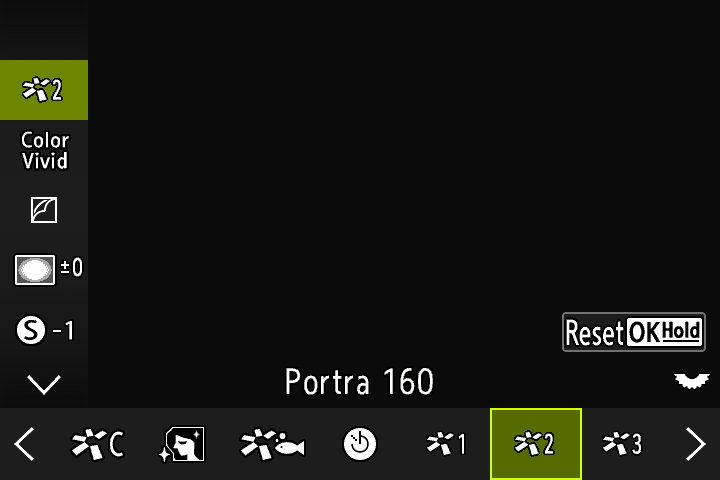

<!-- Generated by scripts/atlas.py. Edit canonical records/metadata, then regenerate. -->

# OM SYSTEM OM-5 Mark II showcase

[Camera overview](../cameras/om5-ii.md)

**[Before you install](../../docs/before-you-install.md)** · Unofficial firmware can leave your camera stuck restarting or unable to start. Recovery from a memory card is not guaranteed.
{ .install-note }

<section class="model-panel" markdown="1">

## Caduceus for OM-5 { #caduceus-om5 }

**Get it:** [v0.2.0-alpha1 (pre-release)](https://github.com/xulfr/caduceus-om5/releases/tag/v0.2.0-alpha1), 20 Nov 2026 · [Install guide](https://github.com/xulfr/caduceus-om5/blob/main/docs/INSTALL.md)
{ .card-get }

For E148 firmware 1.1. Verify the file on the card against the checksum in the release notes.
{ .release-warning }

{ .hero-image }

A look's name on the Picture Mode screen. *Caduceus for OM-5 website.*
{ .image-caption }

- **Color Profiles 1–3 and Monochrome Profiles 1–3** · Alpha. Six hidden Picture Mode slots restored after Color Creator.
- **Custom looks** · Alpha. Up to ten looks from LookLab in one LOOKS.BIN; the trash button steps through them and the look's name is shown.
- **Colour editor** · Alpha. Hue, saturation and lightness for 12 colours, with a tone curve, Sharpness, Contrast and Shading.

[Full project details](../projects/caduceus-om5.md#for-om5-ii) · [Ask or report issues](https://github.com/xulfr/caduceus-om5/issues) · [Report your result](https://github.com/xulfr/om-firmware-atlas/issues/new?template=camera-report.yml&target=OM+SYSTEM+OM-5+Mark+II+%C2%B7+stock+firmware%3A+&package=Caduceus+for+OM-5+%C2%B7+v0.2.0-alpha1)

</section>

<section class="model-panel" markdown="1">

## OMKit { #omkit }

**Get it:** [v0.1.0](https://github.com/necrostaz/omkit/releases/tag/v0.1.0), 20 Nov 2026 · [Install guide](https://github.com/necrostaz/omkit/blob/a29db07f4cab2f9f9688462975ffa510b4d6fd97/docs/platform/om5m2/fw1100/install.md)
{ .card-get }

Unofficial; only for the OM-5 Mark II on firmware 1.1. Never interrupt the firmware update; a power loss while writing leaves no known recovery path.
{ .release-warning }

- **Card-loaded core and modules** · Available. A one-time loader patch starts OMKIT\CORE.BIN from the card on every power-on. Updates are file copies; no card, or OK held at power-on, gives a stock camera.
- **Creative profiles (CREATPRF)** · Available. Three colour and three monochrome profiles in the picture mode strip, edited in the camera's own column (12-sector saturation, tone curve, filter, toning, grain); applied to stills, live view and video.
- **Film look (FILMLOOK)** · Available. One picture mode, i-Enhance by default, becomes a film look; the dials step through .ISP presets on the card, 32 bundled, with a tone curve per preset and grain on stills.

[Full project details](../projects/omkit.md#for-om5-ii) · [Ask or report issues](https://github.com/necrostaz/omkit/issues) · [Report your result](https://github.com/xulfr/om-firmware-atlas/issues/new?template=camera-report.yml&target=OM+SYSTEM+OM-5+Mark+II+%C2%B7+stock+firmware%3A+&package=OMKit+%C2%B7+v0.1.0)

</section>

<section class="model-panel" markdown="1">

## db firmware / om-c-firmware { #db-firmware }

**For this camera:** Korean menus and Hybrid Shutter, both beta.
{ .card-for }

**dbv0.4.3 · The project reports that this build does not work on this camera.** [Read release notes](https://github.com/azqeurio/om-c-firmware/releases/tag/dbv0.4.3).
{ .release-warning }

The maintainer calls this a beta. No test procedure, results or hashes are given.
{ .release-warning }

[Full project details](../projects/db-firmware.md#for-om5-ii) · [Ask or report issues](https://github.com/azqeurio/om-c-firmware/issues)

</section>
